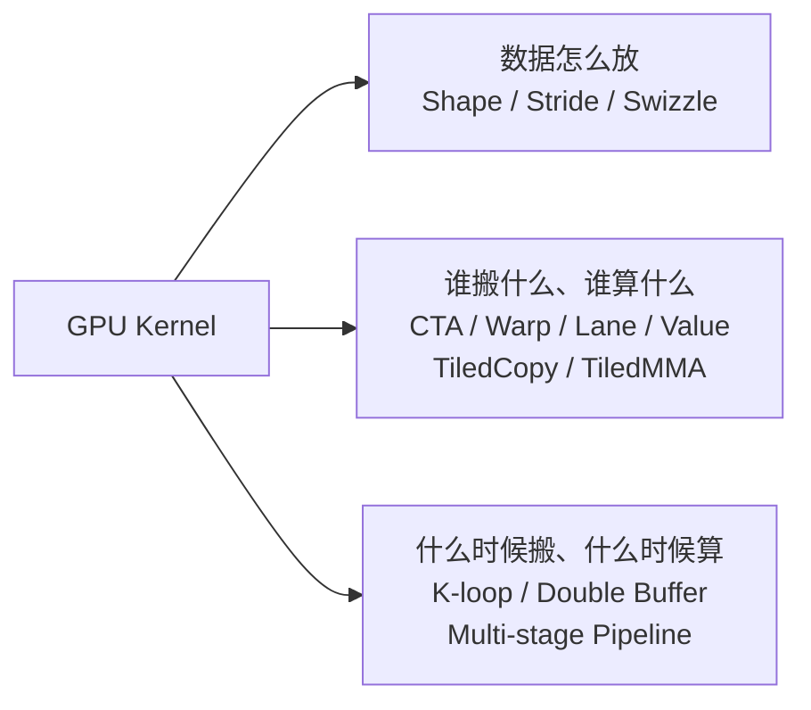

上一篇 [《看懂 GPU GEMM》](../roofline-tensor-core/) 从 Roofline、数据复用、软件流水一路走到了 Tensor Core，也终于在自己的程序里跑出了 WMMA。

那时，脑子里留下的是一条计算层次：

```text
Entire GEMM → CTA Tile → Warp Tile → MMA Tile
```

但还有一个问题没回答。手写 CUDA 时，我可以自己决定一个 block 算哪里、一个 thread 搬什么、shared memory 怎么排、下一块数据什么时候搬。到了工业级 kernel，这些决定怎样组织起来，才能在不同形状和硬件之间复用？

带着这个问题，我开始看 CUTLASS。

最开始只把它当作 NVIDIA 写好的高性能 GEMM 库。真正往里面看之后，更吸引我的，是它表达 kernel 的方式：**把原本藏在线程下标、循环和地址计算里的映射关系，显式地写出来。** CuTe 则提供了描述和组合这些关系的基础工具。

这篇沿着几个小实验往下走：先看逻辑坐标怎样落到数据上，再看线程各自拿哪些值，最后看一条 MMA 的结果怎样分布在整个 warp 里。目标是建立一个能读懂代码的模型。

## 1. Tile 层次

以前写 GEMM，经常调整 `BM`、`BN`、`BK`，以及每线程负责的 `TM`、`TN`。这些数字背后，已经有了工作分配：一个 block 负责 `BM × BN` 的输出，一个 thread 负责其中的一部分，沿 K 方向每轮处理 `BK` 个元素。

到了 warp 级 Tensor Core kernel，这种分配又多了一层。下面是一组帮助理解层次的示意形状：

| 层次 | M × N × K | 回答的问题 |
| --- | --- | --- |
| CTA Tile | 128 × 128 × 32 | 一个线程块在一轮 K tile 中更新多大的输出？ |
| Warp Tile | 64 × 64 × 32 | 一个 warp 负责其中哪一块？ |
| MMA Tile | 16 × 8 × 16 | 一条 MMA 操作覆盖多大的矩阵乘加？ |

CTA，也就是 CUDA 的线程块。在这个例子里，每轮取一块 `128 × 32` 的 A 和一块 `32 × 128` 的 B，更新同一块 `128 × 128` 的累加结果。

如果只在 M/N 平面分配 warp，K 方向不再额外拆给多个 warp，那么输出可以分给四个 warp：

```text
             N = 128
       ┌──────────┬──────────┐
       │  Warp 0  │  Warp 1  │
       │  64×64   │  64×64   │
M=128  ├──────────┼──────────┤
       │  Warp 2  │  Warp 3  │
       │  64×64   │  64×64   │
       └──────────┴──────────┘
```

一个 warp 再用多条 `16 × 8 × 16` 的 MMA 覆盖自己的输出，并沿 K 方向累加。这里的 `BK=32` 是一轮搬运和计算的 K 范围，整次 GEMM 仍要继续走完 K 循环。

这样再看那些模板参数，就容易对应到具体工作：计算范围怎样从整个矩阵分给 CTA，再分给 warp，最后落到指令上。这里讨论的是这种经典的 warp 级组织方式；不同架构和 kernel 也可以采用其他分工。[CUTLASS 的 Efficient GEMM 文档](https://docs.nvidia.com/cutlass/latest/media/docs/cpp/efficient_gemm.html)给出了这套分层的完整背景。

## 2. Layout

真正让我开始觉得 CuTe 有意思，是从 `Layout` 开始的。

先写一个最熟悉的二维行主序布局：

```cpp
using namespace cute;

auto layout = make_layout(
    make_shape(Int<2>{}, Int<4>{}),
    make_stride(Int<4>{}, Int<1>{})
);

print(layout);
print_layout(layout);
```

`Int<2>`、`Int<4>` 表示编译期已知的整数；打印时，CuTe 用 `_2`、`_4` 表示这些静态值。上面的布局打印为 `(_2,_4):(_4,_1)`，对应的下标是：

```text
         j=0  j=1  j=2  j=3
i=0       0    1    2    3
i=1       4    5    6    7
```

也就是：

$$
L(i,j)=4i+j
$$

只把 stride 改成 `(1,2)`，同样的 shape 就得到另一张表：

```text
         j=0  j=1  j=2  j=3
i=0       0    2    4    6
i=1       1    3    5    7
```

此时：

$$
L(i,j)=i+2j
$$

Shape 回答“逻辑坐标的范围是什么”，Stride 回答“沿这些坐标移动时，下标怎样变化”。这里可以先记住：

$$
\boxed{\text{Layout}=(\text{Shape},\text{Stride})}
$$

更根本的理解，是把 Layout 看作一个从坐标到下标的函数。把它接到数据指针上，下标才成为数据的元素偏移；Layout 本身也能用来描述线程和 value 等其他索引关系。[CuTe Layout 文档](https://docs.nvidia.com/cutlass/latest/media/docs/cpp/cute/01_layout.html)也是从这个定义开始的。

### 默认布局

我还踩了一个很小、却很有代表性的坑：

```cpp
make_layout(make_shape(Int<2>{}, Int<4>{}))
```

省略 stride，得到的是 `(_2,_4):(_1,_2)`。默认的 `LayoutLeft` 让最左边的 mode 连续；在这个普通二维例子里，就是列主序。

所以，看到 `(M,N)`，不能直接按二维 C 数组去理解它的存储顺序。**逻辑上有多少行列，和数据实际怎样排列，需要分别看。**

### 层次布局

接着，我把第二维的 `4` 拆成了 `(2,2)`：

```text
Shape  = (2,(2,2))
Stride = (4,(2,1))
```

如果自然坐标写作 `(i,(j,k))`，映射就是：

$$
L(i,(j,k))=4i+2j+k
$$

打印成二维表时，却出现了这样的顺序：

```text
         c=0  c=1  c=2  c=3
i=0       0    2    1    3
i=1       4    6    5    7
```

这里的列标题 `c` 是第二个 mode 内部的展平坐标，按 `c=j+2k` 解开。因此 `c=0,1,2,3` 依次对应 `(j,k)=(0,0),(1,0),(0,1),(1,1)`，再代入 stride，才得到 `0,2,1,3`。

我最初的困惑，正是把表头的逻辑坐标和表格里的输出下标混在了一起。

这个例子很小，却让我理解了层次布局的用途：一个维度可以保留内部结构。真实 kernel 里的索引，也常常要同时描述 warp、lane、每线程的 value，以及 tile 内外的重复。把这些结构留在布局里，后面的操作才有机会沿着某个层次去切分和组合。

## 3. Tensor

有了 Layout，Tensor 就容易理解了。以前的一行：

```cpp
A[i * K + k]
```

包含两件事：`A` 提供数据入口，`i * K + k` 把坐标变成偏移。CuTe 把它们分别表达为 Engine 和 Layout：

$$
\boxed{\text{Tensor}=\text{Engine}+\text{Layout}}
$$

例如，把前面的行主序 layout 接到一个数组指针上：

```cpp
float data[8] = {0, 1, 2, 3, 4, 5, 6, 7};
float* ptr = data;
auto tensor = make_tensor(ptr, layout);

printf("%.0f\n", tensor(1, 2));  // 6
```

这里的 tensor 是一个 view，沿用原数组的数据；它没有复制出另一块二维数组。我在学习时也遇到过数组参数的模板推导问题，显式用 `float*` 后，代码的意图反而更清楚了。

不过，“Tensor 是 view”只适用于这里的指针构造。CuTe 也有拥有存储的 Tensor，例如用静态 layout 创建的线程私有数组。[CuTe Tensor 文档](https://docs.nvidia.com/cutlass/latest/media/docs/cpp/cute/03_tensor.html)区分了这些构造方式。

这一区别很快就会派上用场：partition 给线程一个访问原数据的 view，而 fragment 可以为线程提供存放数据的空间。

## 4. TiledCopy

接下来，问题从“数据怎么放”变成了“谁来搬这些数据”。

一个 thread 往往负责多个值，所以仅有 thread ID 还不能确定一个元素。还需要它在线程内部的 value ID：

```text
(thread, value) → tensor coordinate
```

这就是 Thread–Value mapping。

我用下面的配置构造了一个 TiledCopy：

```cpp
auto tiled_copy = make_tiled_copy(
    Copy_Atom<UniversalCopy<uint128_t>, float>{},
    Layout<Shape<_8, _8>>{},
    Layout<Shape<_4, _1>>{}
);
```

三个参数分别负责三件事：

| 对象 | 这个例子里的含义 |
| --- | --- |
| Copy Atom | 用 128-bit 的拷贝操作搬运 float |
| Thread Layout | 把 64 个线程按 8 × 8 的逻辑布局组织起来 |
| Value Layout | 每个线程的 4 个值按 4 × 1 组织起来 |

在这组布局下，线程和 value 一起覆盖的 tile 是：

$$
(8\times4)\times(8\times1)=32\times8
$$

程序打印出：

```text
Tile shape: (_32,_8)
TV shape: ((_8,_8),(_4,_1))
```

`64 threads × 4 values` 给出了总量，而 `((_8,_8),(_4,_1))` 还保留了它们在两个逻辑方向上的结构。

### 打印映射

怎样知道每个 thread 真正负责哪个坐标？我用了一个很有用的办法：构造 identity tensor，让每个逻辑位置返回它自己的坐标，再按 TiledCopy 的规则划分。

```cpp
auto ref = make_identity_tensor(Shape<_32, _8>{});
auto tv = tiled_copy.tidfrg_S(ref)(_, _, Int<0>{});

// tv(thread_id, value_id) 返回对应的 (m,n)
```

这样得到的输出，直接就是答案：

| Thread | V0 | V1 | V2 | V3 |
| ---: | --- | --- | --- | --- |
| 0 | (0, 0) | (1, 0) | (2, 0) | (3, 0) |
| 1 | (4, 0) | (5, 0) | (6, 0) | (7, 0) |
| 8 | (0, 1) | (1, 1) | (2, 1) | (3, 1) |
| 9 | (4, 1) | (5, 1) | (6, 1) | (7, 1) |

也就是说，T0～T7 覆盖第 0 列，T8～T15 覆盖第 1 列，每个线程沿 M 方向拿四个值。

对这组具体配置，设线程编号为 `t`，value 编号为 `v`，可以直接写出：

$$
\begin{aligned}
m&=4(t\bmod8)+v\\
n&=\left\lfloor\frac{t}{8}\right\rfloor
\end{aligned}
$$

看见这张表之后，Thread Layout 和 Value Layout 就有了具体含义：前者安排线程之间的位置，后者安排同一个线程内部的值。

### 地址连续性

这里还有一步不能省略。每个线程拿到的是逻辑上沿 M 方向相邻的四个 float，它们是否适合一次 128-bit 搬运，还要看 tensor 的存储布局。

实际 copy kernel 用的是 `(32,8):(1,32)`，也就是：

$$
\operatorname{offset}(m,n)=m+32n
$$

把刚才的 Thread–Value mapping 代进去：

$$
\begin{aligned}
&\operatorname{offset}(t,v)\\
&=4(t\bmod8)+v+32\left\lfloor\frac{t}{8}\right\rfloor\\
&=4t+v
\end{aligned}
$$

例如 Thread 9 的逻辑坐标是 `(4,1)` 到 `(7,1)`，实际元素偏移则是 `36,37,38,39`，恰好连续。四个 float 占 `16 B`，也就是 `128 bit`；在基地址满足 16 字节对齐时，每线程的起点也满足这个对齐要求。

如果保持同一套线程分配，却把 tensor 改成行主序 `(32,8):(8,1)`，沿 M 移动一格就要跨过八个 float。这四个值便不能原样当作一组连续的 128-bit 访问。

所以，看 TiledCopy 时，要把两段关系接起来：

```text
(thread, value) → 逻辑坐标 → 实际元素偏移
```

**搬运分工、数据布局和拷贝宽度必须相互匹配。** 单看“每线程四个值”，还不足以说明这次访问的地址分布。

## 5. Partition

有了 TiledCopy，kernel 里就不需要重复手算上面的坐标了。先把源、目标指针接到同一个 layout 上：

```cpp
auto layout = make_layout(Shape<_32, _8>{});
auto S = make_tensor(make_gmem_ptr(src), layout);
auto D = make_tensor(make_gmem_ptr(dst), layout);

auto thr_copy = tiled_copy.get_thread_slice(threadIdx.x);
auto tS = thr_copy.partition_S(S);
auto tD = thr_copy.partition_D(D);
```

`get_thread_slice` 选出当前线程的工作分配，`partition_S`、`partition_D` 得到它应该访问的源、目标 Tensor view。

到这里，还没有读取源数据，也没有向目标写入任何元素。Partition 改变的是当前线程看见哪些位置。

随后创建一个线程私有的 fragment，再发起拷贝：

```cpp
auto frag = make_fragment_like(tD);

copy(tiled_copy, tS, frag);  // Global Memory → fragment
copy(tiled_copy, frag, tD);  // fragment → Global Memory
```

这个 fragment 用于承接数据，在 GPU kernel 中通常由寄存器承载。实际是否出现 spill，仍要看编译结果和资源使用。

这个小 kernel 用一个 block、64 个线程搬完 `32 × 8` 的 tile，输出是：

```text
tS shape: ((_4,_1),_1,_1)
frag shape: ((_4,_1),_1,_1)
Verification: PASS
```

这里第一部分 `(_4,_1)` 对应这组拷贝中每线程的四个 float；后面的 `_1,_1` 表示两个方向都没有额外的 tile 重复。

到这一步，几个对象终于连成了一条数据路径：Layout 描述数据位置，TiledCopy 描述搬运分工，partition 生成线程的访问 view，fragment 提供中间存储，`copy` 执行搬运。

## 6. TiledMMA

理解 TiledCopy 之后，再看 TiledMMA，就能找到熟悉的结构。

Copy Atom 描述基本搬运操作，TiledCopy 把它扩展成一个 tile 的搬运分工；MMA Atom 描述基本矩阵乘加操作，TiledMMA 则组织这些操作怎样覆盖更大的计算范围。

MMA Atom 除了指令形状和类型，还描述参与线程及 A、B、C fragment 的映射。不同架构的参与范围可以不同；这里先看一个 warp 级例子。[CuTe MMA Atom 文档](https://docs.nvidia.com/cutlass/latest/media/docs/cpp/cute/0t_mma_atom.html)解释了指令包装、Traits 和 Atom 之间的关系。

我构造的是：

```cpp
auto tiled_mma = make_tiled_mma(
    SM80_16x8x16_F16F16F16F16_TN{},
    Layout<Shape<_1, _1>>{},
    Tile<_16, _8, _16>{}
);
```

这里暂时只放一个 warp 级 MMA Atom，覆盖 `16 × 8 × 16`。按普通矩阵乘法的记法，它执行：

$$
D_{16\times8}
=A_{16\times16}B_{16\times8}+C_{16\times8}
$$

这个具体操作的 A、B、C、D 都是 FP16。它的累加类型与上一篇教学 WMMA 中的 FP32 累加不同，后面的 value 数量也要按这里的类型理解。

### C Fragment

打印 TiledMMA，其中两项是：

```text
Shape_MNK: (_16,_8,_16)
LayoutC_TV: ((_4,_8),(_2,_2)):((_32,_1),(_16,_8))
```

`LayoutC_TV` 的 shape 分成 Thread 和 Value 两部分：32 个 lane，每 lane 四个逻辑累加值，正好覆盖 `16 × 8 = 128` 个输出位置。

继续使用 identity tensor，就能看到这些值各自对应 C 的哪个坐标：

```cpp
auto C = make_identity_tensor(Shape<_16, _8>{});
auto thr_mma = tiled_mma.get_slice(lane);
auto tC = thr_mma.partition_C(C);

// tC(i) 返回当前 lane 的第 i 个逻辑 value 对应的坐标
```

部分输出如下：

| Lane | V0 | V1 | V2 | V3 |
| ---: | --- | --- | --- | --- |
| 0 | C(0, 0) | C(0, 1) | C(8, 0) | C(8, 1) |
| 1 | C(0, 2) | C(0, 3) | C(8, 2) | C(8, 3) |
| 8 | C(2, 0) | C(2, 1) | C(10, 0) | C(10, 1) |
| 31 | C(7, 6) | C(7, 7) | C(15, 6) | C(15, 7) |

我第一次真正看见了“fragment 分布在整个 warp 的寄存器中”是什么样子：一个 lane 的值，可能分散在不同的行；完整输出由所有 lane 的 fragment 拼起来。

对这里的 C mapping，令 lane 编号为 \(\ell\)，value 编号为 \(v\)，也可以写成：

$$
\begin{aligned}
m&=\left\lfloor\frac{\ell}{4}\right\rfloor
+8\left\lfloor\frac{v}{2}\right\rfloor\\
n&=2(\ell\bmod4)+(v\bmod2)
\end{aligned}
$$

这是这条 MMA 操作的 fragment 约定。CuTe 把它表达为 Layout，后续数据搬运就能围绕这套约定组织起来。

还要区分**逻辑 value 数和物理寄存器数**：这里每 lane 有四个 FP16 累加值，在该指令接口里打包为两个 32-bit 寄存器，不能直接理解成四个 32-bit accumulator。坐标和打包规则可以对照 [PTX 的 m16n8k16 fragment 说明](https://docs.nvidia.com/cuda/parallel-thread-execution/index.html#warp-level-matrix-fragment-mma-16816-float)。

这个实验只在主机端打印映射，没有执行 MMA，也没有验证一个 GEMM。它帮我看清的是指令要求怎样分配数据；真正把 A、B 搬进合适的 fragment，再执行计算，是下一步的工作。

## 7. 映射与调度

到这里，再回头看一个 GPU kernel，我会把它拆成三个相互关联的问题：



这张图是我整理学习过程的方式。本文的小实验主要覆盖前两部分，时间调度仍接着上一篇的 K 循环和流水线去理解。

手写 CUDA 时，它们挤在 `threadIdx.x`、shared memory 数组、循环和同步指令里。现在，至少能把每一段代码对应的问题分辨出来了。

更重要的是，这三件事要一起决定：

| 想做的优化 | 需要一起考虑的关系 |
| --- | --- |
| 使用更宽的向量拷贝 | 每线程的值要落在合适的连续地址上，并满足对齐要求 |
| 把数据送给 MMA | 搬运得到的 fragment 要匹配指令要求的 lane/value 分布 |
| 调整 shared-memory 布局 | 要同时照顾协作写入、后续读取和 bank 访问 |
| 增加 pipeline stage | 可以提前准备更多数据，同时也增加缓冲区和资源占用 |

原来手写 CUDA 时遇到的那些取舍，在这里仍然存在。只是现在，它们有了更清楚的表达位置，也更容易看见某个决定会影响哪一段数据路径。

## 8. 下一站：Triton

继续往下，可以展开 A、B fragment，组合更多 MMA Atom，再研究 `ldmatrix`、shared-memory swizzle、`cp.async`、multi-stage pipeline 和 epilogue。每一项都值得花时间。

但对于我现在想走的 AI Infra / AI Compiler 路线，这次收获已经很具体了：能从一份存储布局走到线程分工，再走到指令要求的数据分布。以后读一个 kernel，至少知道先把哪些关系画出来。

上一篇结束时，我开始理解为什么一个 GEMM 能快。这一篇之后，我又开始看见：**这些性能决定，在一个工业 kernel 框架里怎样被表达和组合。**

接下来想去看 Triton。到了 `tl.arange`、`tl.load`、`tl.dot` 这样的接口，同样的矩阵仍然需要分给线程，数据仍然需要落到地址上，指令也仍然有自己的操作数约定。

我想带着这次建立的模型去问：

> **哪些映射可以交给编译器决定，哪些决定仍然需要程序员提供？**

这会是下一段学习的起点。

## 源码与复现

本文的三个完整实验来自 `mini-tensor/cute_example`，在写作时重新编译、运行核对过。学习环境是 WSL Ubuntu、CUTLASS 4.8.0、CUDA Toolkit 13.3，以及 RTX 4070 Laptop，GPU 编译目标为 `sm_89`。

| 源码 | 核对的内容 |
| --- | --- |
| [cute_tiled_copy_mapping.cu](../../downloads/cute_tiled_copy_mapping.cu) | 64 个线程与每线程四个值覆盖的坐标 |
| [cute_tiled_copy_kernel.cu](../../downloads/cute_tiled_copy_kernel.cu) | 实际执行 32 × 8 tile 的拷贝并逐元素比较 |
| [cute_tiled_mma_mapping.cu](../../downloads/cute_tiled_mma_mapping.cu) | 单个 warp 级 MMA 的 C fragment 坐标 |

下载文件后，下面的命令使用我本机的 CUTLASS 安装位置；在其他环境中，需要修改头文件路径和 GPU 编译目标：

```bash
nvcc -O3 -std=c++17 --expt-relaxed-constexpr \
  -gencode=arch=compute_89,code=sm_89 \
  -I"$HOME/.local/opt/cutlass-4.8.0/include" \
  -I/usr/local/cuda/include/cccl \
  cute_tiled_copy_kernel.cu -o cute_tiled_copy_kernel

./cute_tiled_copy_kernel
```

把输入文件和输出程序名替换成表中另外两项，就可以运行对应的映射打印实验。它们使用同一套编译参数。

这几个程序是固定形状的教学实验：copy kernel 只搬一个完整 tile，`PASS` 检查的是这次输入下的元素一致性。这里没有测性能，也没有实现通用尺寸的 CUTLASS GEMM。
